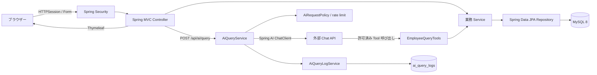

# システム構成と卒業研究メモ

## 構成

通常の社員・部署・集計処理は Controller から Service を経て Repository に到達します。AI は MySQL 接続情報も SQL 実行機能も持たず、5つの Java Tool を介して既定の Repository 処理だけを呼び出します。Tool の社員一覧は最大20件で、`EmployeeSummary` の許可リストにある工号・氏名・部署・役職・入社日・状態だけを含みます。

## テーブル

| テーブル | 用途 | 主な関係 |
|---|---|---|
| `departments` | 部署名と説明 | `employees` から 1 対多で参照 |
| `employees` | 社員情報、状態、論理削除フラグ | 部署外部キーは `ON DELETE RESTRICT` |
| `app_users` | Session Form Login 用の BCrypt Hash とロール | 社員データとは独立 |
| `ai_query_logs` | AI 操作種別、結果状態、経過ミリ秒、記録時刻 | 個人または問答本文との関連なし |

メールアドレスは任意かつユニーク、電話番号は任意です。論理削除済み社員も工号を予約し続けます。社員統計は `deleted=false` を条件とし、在籍人数はさらに `status='ACTIVE'` を条件にします。

## AI 照会の流れと境界

1. ログイン済み利用者が日文質問を最大500文字で送信します。CSRF は有効です。
2. `AiRequestPolicy` が敏感情報、更新要求、指示上書き、未対応の全状態社員数をモデル呼び出し前に拒否します。
3. 利用者ごとの1分10回制限と1問い合わせ最大6回の外部モデル呼び出し制限を確認します。
4. ChatClient に固定 System Prompt と社員 Tool のみを渡します。モデルが提案した操作は Java Tool の範囲でのみ実行されます。
5. `AiQueryLogService` は実行した固定 Tool 名（または一般照会）、結果状態・時間だけを記録します。質問・回答、メール、電話、パスワードは記録しません。Tool を呼び出さずに応答した場合、画面の出典はデータベースと表示しません。

AI の回答文そのものは生成モデルの文章であり、Tool の数値結果を引用した場合でも説明文が誤る可能性があります。実験では各回答を独立した SQL の結果と照合してください。外部モデルを使う場合、質問と Tool が返した許可項目は外部 API に送信されます。実在する個人情報を使わないでください。

## 自動テストと手動確認

自動テストの実行方法と T01〜T12 は [test-cases.md](test-cases.md) を参照してください。実行していない試験の結果は記入せず、実験問題は [ai-experiment-template.csv](ai-experiment-template.csv) に回答を実測した後で記録します。画面キャプチャはアプリを起動し、実際の画面を確認してから追加してください。

## 卒業報告の章立て案

1. **はじめに** — 表計算での社員管理における検索・集計課題、研究目的、対象範囲。
2. **関連技術** — Java 21、Spring Boot、Spring MVC、JPA、MySQL、Spring Security、Spring AI Tool Calling。
3. **要件分析と設計** — ADMIN/VIEWER、画面、ER 関係、統計条件、AI の許可境界。
4. **実装** — CRUD、論理削除、セッション認証、ページング、AI Tool の処理順序。
5. **評価と考察** — T01〜T12 の結果、20問×3回の SQL 照合、選択 Tool、拒否結果、応答時間と失敗例。
6. **おわりに** — 成果、単一会社・単一テナント構成、モデル依存、未実施評価と今後の課題。

結果章では未実行の数値を記述しないでください。各実験には実行日時、モデル名、質問データ版、データベース初期状態を添えて再現条件を明示します。
